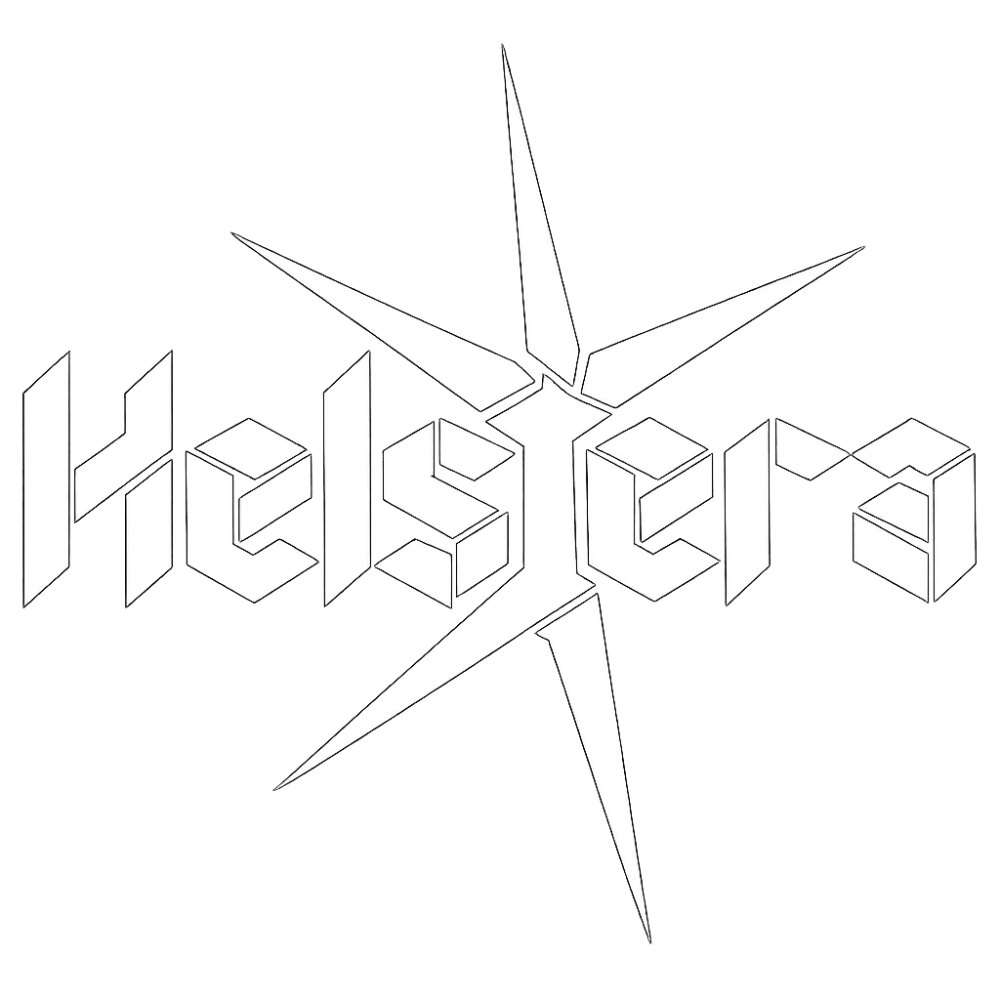

<p align="center">
  
</p>

<h1 align="center">
  Helstera
</h1>

<p align="center">
  Enterprise-grade AI canvas studio for design & video teams.<br/>
  Infinite canvas · Brand-consistent AI generation · Real-time collaboration
</p>

<p align="center">
  
</p>

<p align="center">
  
  
  
  
  
  
  
  
  
  
</p>

<p align="center">
  
</p>

---
> Runtime note: the active deployment is local-only. Use local PostgreSQL (`DATABASE_URL`), local filesystem Storage (`STORAGE_ROOT`), local sessions, and the local Worker queue. Supabase migrations and the old mock are historical reference material and are not loaded by the application.

## Current implementation status

2026-11-10：桌面 0.2.30 已发布，加入扫描限速、断盘进度保留、目录预览重启恢复和确认后的重复内容合并；进度见 [本地扫描与合并验收](docs/audit/desktop-030-storage-controls.md)。

2026-11-10：桌面 0.2.29 已发布，加入重复素材暂停/重启续扫、目录逐项关联预览和封面缓存设置；真实大文件与发布状态见 [本地存储续扫验收](docs/audit/desktop-029-storage-resume.md)。

2026-11-10：桌面 0.2.28 增加本地图片缩略图/视频封面缓存、工作区磁盘分类与重复内容校验，以及素材改名/移动后的确认关联。缓存受容量和数量上限约束，原文件保留；macOS Intel 原生安装验收与发布证据见 [本地媒体验收](docs/audit/desktop-028-local-media.md)。

2026-11-10：桌面 0.2.27 增加离线图片/视频真实预览、磁盘容量预警、按工程确认清理和已校验本地副本的云端释放。释放前说明跨设备影响，释放后可从本地重新确认恢复；原生包、生产播放和清理证据见 [存储管理验收](docs/audit/desktop-027-storage-management.md)。

2026-11-10：桌面 0.2.26 增加离线快照结构预览与版本差异、本地待恢复队列、上传任务继续/清理和跨盘素材映射。快照浏览不联网，恢复需再次确认；云端复用已有素材、减少同卷复制，并将未完成分片保留时间缩短为 6 小时。Windows 真实升级、生产视频恢复与三平台原生包验收见 [本地优先验收](docs/audit/desktop-026-local-first.md)。

2026-11-10：桌面 0.2.25 新增本地快照列表、工程筛选和时间排序，大视频支持分片恢复与重启续传；270.1 MB 视频已在生产恢复并流式播放。原生包、升级和界面证据见 [大视频与快照验收](docs/audit/desktop-025-large-restore.md)。

2026-11-10：桌面 0.2.24 新增本地工程/对话快照恢复入口、私有素材重传、可校验的断点续传及速度/剩余时间；真实 Windows 升级、67.9 MB 视频续传与生产恢复已验收，范围和证据见 [恢复与续传验收](docs/audit/desktop-024-restore-resume.md)。

2026-11-10：桌面 0.2.23 新增离线可用的首次工作区配置、按账户保存云端原文件和画布/对话快照、流式写入校验、失败重试与重启恢复。生产私有素材已验证真实落盘，范围和证据见 [本地工作区验收](docs/audit/desktop-023-local-workspace.md)。

2026-11-10：桌面 0.2.22 减少重复打包内容，Windows 安装器缩小约 13.7%、解包占用缩小约 33.2%；补齐中文安装说明、运行中升级保护、断网/崩溃恢复及窗口位置保存。Windows 实测与发布边界见 [桌面验收](docs/audit/desktop-022-20261110.md)。

2026-11-09：修复视频编辑器启动卡顿并上线：启动阶段拆分为资源下载、编译、预览和就绪，45秒编译看门狗会中止失控工作线程并保留本机工程；编辑器 WASM 与入口脚本启用 gzip 静态压缩。90秒混合帧率长片、取消后刷新恢复、窄屏键盘和 Windows 接管页面 200% 缩放均通过，线上证据见 [HS 闭环验收](docs/audit/hs-closure-20261109.md)。

2026-11-09：素材进入画布、真实时间线预览、私有音频上传、独立成片导出与素材库回流已上线；未领取任务取消退款和编辑回执恢复完成定向验证。`712a499` 的 Agent 与三平台桌面 CI 全部通过。范围、生产证据及未覆盖边界见 [HS 闭环验收](docs/audit/hs-closure-20261109.md)。

2026-11-08：新增多光标网页重建演示与同步 WebM 录制，从 Agent 浏览器侧栏或对话发起，逐次确认后执行，结果回存素材库和聊天。效果、许可、录制范围与真实验收见 [网站演示录制](docs/website-presentation-20261108.md)。

2026-11-08：隔离浏览器支持同站账号密码登录后体验录制，凭据经专用表单加密暂存并一次性消费；登录过程不录制，结果复用私有素材与聊天回写。支持范围与 Web、Windows 验收见 [登录后体验录制](docs/website-login-recording-20261108.md)。

2026-11-08：网站体验支持目标对话规划、指定页面顺序、主动登录接管、24 小时会话记忆及录像导入视频工程。真实模型、本站授权账号与 Windows 联合验收见 [对话式网站体验](docs/website-journey-20261108.md)。

2026-11-08：网站录像改为页面就绪后连续滚动、30fps 与目标时长输出；隐私输入改为马赛克，新增集中会话撤销和对话配音确认。真实旧片/新片对比与验收范围见 [录像质量修复](docs/recording-quality-20261108.md)。

2026-11-07：新增 Web/桌面共用的 Agent 浏览器观察侧栏，服务端接入经过校验的 Chromix，支持真实画面、动作光标、暂停和刷新恢复。权限、许可、Windows 客户端与 Linux 沙箱证据见 [Agent 浏览器验收](docs/agent-browser-view-20261107.md)。

2026-11-07：女装试穿模型与逐次费用确认、刷新取回结果、全站实底下拉菜单已完成本轮改造。真实 PostgreSQL、浏览器回归与生产发布证据见 [试穿计费与组件验收](docs/fashion-billing-controls-20261107.md)；上游付费真人试穿效果与本轮事务测试分开记录。

视频工作区已接入当前合成 AI 编辑与 OneTake 文字剪辑。功能对照、真实模型/浏览器/Windows 候选程序证据和部署边界见
[`docs/onetake-integration-20261106.md`](docs/onetake-integration-20261106.md) 与
[`docs/video-ai-editor-acceptance-20261106.md`](docs/video-ai-editor-acceptance-20261106.md)。下列通用 UX 数量保留自较早验收，不代表本次新增功能的覆盖率。

2026-11-06 已部署到生产 `/video/`，通过真实转写、确认导出、当前合成替换、刷新恢复和聊天视频播放验收。生产模型 `grok-4.6` 返回结构化剪辑计划。开发分支 `codex/agent-workspace-ci` 的代码提交 `5816df0` 已通过 Windows/macOS/Linux 候选 CI；安装过程与各平台原生导出边界见验收记录。

2026-11-06 后续闭环修复已发布：私有素材权限/删除/到期清理，视频窄屏与弹窗/语言，以及受约束目标计划、逐步审批和恢复。真实生产目标完成网站录制→MP4剪辑→素材库/聊天回写；核验重试没有重复录制，刷新后视频可播放。发布中发现并补修了模型等待时间不一致和身份初始化与媒体保存的数据库死锁。具体提交、验证及未验收边界见[`docs/audit/closure-fixes-20261106.md`](docs/audit/closure-fixes-20261106.md)；不是全部100项审计已完成。

聊天现已支持消息复制和正文Ctrl/Cmd+C，重连旧快照不再覆盖新的流式回答；生产复制验收与Electron沙箱启动/崩溃恢复回归见[`docs/chat-copy-recovery-20261106.md`](docs/chat-copy-recovery-20261106.md)。

2026-11-07 已上线划词操作：选择消息片段后可直接复制或添加为输入框引用，保留已有草稿且不自动发送；宽窄布局切换保留引用。实际划选、复制、引用和320px恢复证据见[`docs/chat-selection-20261107.md`](docs/chat-selection-20261107.md)。

视频编辑器已移除品牌菜单，合成/选中内容的AI上下文与批注入口改为本站AI面板；上下文进入计划预览和逐项确认流程。改动和线上菜单验收见[`docs/video-internal-ai-20261107.md`](docs/video-internal-ai-20261107.md)。

后续已统一为一个AI修改和导出入口，并补齐修改对象、常用操作、方案失效、确认应用、撤销与成片回流。真实浏览器/数据库中的标题修改→可播放WebM导出→撤销，以及回执丢失恢复均通过；详情见[`docs/video-creator-flow-20261107.md`](docs/video-creator-flow-20261107.md)。

AI方案新增时间线差异对比及字幕、配乐、剪辑逐项撤销；工程动作日志支持刷新恢复，完整撤销保留已消费标记。真实模型复杂方案、浏览器导出解码和原工程恢复已通过；发布状态与边界见[`docs/video-timeline-undo-20261107.md`](docs/video-timeline-undo-20261107.md)。

视频页已上线持续对话操控，覆盖已有图层修改、画幅、预览控制、明确对话确认和本机历史恢复。真实模型多轮修改与线上自定义模型回复已验收，最新Agent CI通过；安装包及能力边界见[`docs/video-conversation-20261107.md`](docs/video-conversation-20261107.md)。

对话动画和素材流程已上线：GSAP关键帧、淡化/滑入转场、图片插入、私有素材搜索导入和强制费用确认。正式Windows候选实际运行通过；用户图片的合成副本完成真实模型修改、MP4导出、私有保存和重新导入，原合成保留。完整证据及付费生成验收边界见[`docs/video-motion-materials-20261107.md`](docs/video-motion-materials-20261107.md)。

The current GitHub snapshot includes the creator-workspace UX pass and the
reliability work that is present in this checkout. The detailed 100-item
acceptance matrix is tracked in
[`docs/CREATOR-WORKSPACE-UX-100.md`](docs/CREATOR-WORKSPACE-UX-100.md).

- 51 UX items are implemented and covered by focused checks.
- 46 items are locally improved but still require browser or manual evidence.
- 3 items remain explicitly open: breadcrumbs, 200% zoom verification, and
  rendered contrast verification.
- Verified locally: Web typecheck, 53 Web Vitest files / 201 tests, Server
  typecheck, 87 Server Vitest files / 468 tests, Web production build, and
  signed-in workspace viewport checks at 320/390/768px including Chromium and
  iPhone Safari.
- The broader browser suite still contains unrelated legacy assumptions; its
  known failures are recorded in the release-status document.
- This snapshot is not a production deployment. Runtime and provider behavior
  must be rechecked in the target environment before release.

See [`docs/RELEASE-STATUS-2026-10-18.md`](docs/RELEASE-STATUS-2026-10-18.md)
for the publication boundary, verification evidence, and remaining work.


## 💡 Helstera 是什么

Helstera 是面向创意与营销团队的 **企业级 AI 画布工作台**。一个无限画布，AI 直接在画布上生成图、视频、布局、文案，团队在同一个画布上协作，所有产出自动遵循品牌规范。

**Helstera 解决三个企业痛点：**

1. **品牌一致性** — Brand Kit 集中管理色板、字体、Logo，AI 每次生成都自动遵循，告别"五颜六色"的散乱设计
2. **团队协作效率** — 不再丢 PS 源文件、不再传 PNG，设计师、文案、运营、市场都在同一个画布上动手
3. **企业级 AI 能力** — 15+ 图片模型（Imagen 4、DALL-E、Flux、Recraft 等）和 8+ 视频模型（Veo 3.1、Kling、Seedance、Sora）按需切换，按品牌自动挑选

**底层能力：** LangGraph 驱动的 Agent 编排，Excalidraw 无限画布，Supabase（Auth + Storage + PostgreSQL + PGMQ 队列），Fastify API，WebSocket 流式响应。前端 Next.js 15 + React 19 + Tailwind 4，类型安全的全栈 TypeScript。

**三端体验：** Web 端（浏览器开箱即用）、桌面端（Electron 打包，原生菜单/通知/离线）、移动端（响应式 + PWA，iPad/手机都能编辑）。

<p align="center">
  
</p>

---

## ✨ Features

🗣️ **对话式画布设计**
- 在无限画布上和 AI 对话，直接生成、编辑、排版
- 多轮对话迭代，说"把左边那张图换成暖色调"就行
- Agent 看得懂画布上下文，知道你在说哪个元素

🖼️ **图片生成（15+ 模型）**
- Google Imagen 4 / Gemini Image / Vertex AI
- OpenAI DALL-E 3 / GPT Image
- Replicate: Flux Kontext, SDXL, Recraft, Seedream...
- 填自己的 API Key，按需组合

🎬 **视频生成**
- Google Veo 3.1 / 3.0 / 2.0（文生视频、图生视频）
- Replicate: Kling, Seedance, Wan, Sora, Hailuo...
- 支持原生音频生成

🎨 **无限画布**
- 基于 Excalidraw，自由拖拽、缩放、分层
- AI 生成的素材直接落在画布上，不用手动导入
- 导出、截图、分享

🏷️ **Brand Kit**
- 设定品牌色、字体、Logo
- AI 生成时自动遵循品牌规范
- 集成 Google Fonts

💰 **积分 & 付费**
- 内置积分系统，按量计费
- LemonSqueezy 订阅集成
- 免费用户每天有基础额度

🧩 **可扩展技能系统**
- Markdown 定义 workspace 技能
- 按项目扩展 Agent 能力

---

## 🏗️ Architecture

```
┌─────────────┐     WebSocket / REST      ┌─────────────────┐
│   Next.js   │ ◄──────────────────────►  │  Fastify API    │
│   Frontend  │                           │  + LangGraph    │
│  (Vercel)   │                           │  Agent (Railway) │
└─────────────┘                           └────────┬────────┘
                                                   │ PGMQ
                                          ┌────────▼────────┐
                                          │    Worker(s)     │
                                          │  Image / Video   │
                                          │  Generation      │
                                          │  (Railway)       │
                                          └────────┬────────┘
                                                   │
                                          ┌────────▼────────┐
                                          │    Supabase      │
                                          │  PostgreSQL      │
                                          │  Auth / Storage  │
                                          └─────────────────┘
```

| Component | Tech | Role |
|-----------|------|------|
| **Frontend** | Next.js 15 + React 19 + Tailwind CSS 4 | Canvas UI, chat panel, workspace |
| **API Server** | Fastify 5 + LangGraph | Agent runtime, WebSocket, REST API |
| **Worker** | Node.js poll-based consumer | Async image/video generation jobs |
| **Database** | Supabase (PostgreSQL) | Data, auth, storage, job queue (PGMQ) |
| **Canvas** | Excalidraw 0.18 | Infinite canvas rendering |
| **AI** | LangChain + LangGraph | Agent orchestration, tool calling |
| **Queue** | PGMQ | Reliable async job processing |

---

## 🛠️ Tech Stack

| Layer | Technology |
|-------|-----------|
| Monorepo | Turborepo + pnpm |
| Frontend | Next.js 15 (App Router), React 19, Tailwind CSS 4 |
| Canvas | Excalidraw |
| Backend | Node.js, Fastify 5, TypeScript |
| AI Framework | LangChain 1.2, LangGraph 1.2 |
| LLM Providers | OpenAI, Google Gemini, Google Vertex AI |
| Image Generation | Imagen, DALL-E, Replicate (13+ models) |
| Video Generation | Google Veo 3.x, Replicate (Kling, Sora, Seedance, etc.), Metaso MiniMax H3 |
| Database | PostgreSQL (Supabase) |
| Auth | Supabase Auth (Magic Link + OAuth) |
| Storage | Supabase Storage (S3-compatible) |
| Queue | PGMQ (PostgreSQL native) |
| Payments | LemonSqueezy |
| Linting | Biome |
| Testing | Vitest |

---

## 🚀 Getting Started

### Prerequisites

- **Node.js** >= 20
- **pnpm** >= 10 (`npm install -g pnpm`)
- **Supabase CLI** (`brew install supabase/tap/supabase`)
- A [Supabase](https://supabase.com) project (free tier works)
- At least one AI API key (Google or OpenAI)

### 1. Clone & Install

```bash
git clone https://github.com/helstera/helstera.git
cd helstera
pnpm install
```

### 2. Set Up Supabase

Create a Supabase project at [supabase.com](https://supabase.com), then apply migrations:

```bash
supabase link --project-ref YOUR_PROJECT_REF
supabase db push
```

This creates all required tables, RLS policies, storage buckets, and the PGMQ job queue.

### 3. Configure Environment

```bash
cp .env.example .env.local
```

Edit `.env.local` with your credentials:

```bash
# ── Required: Supabase ──────────────────────────────────────
SUPABASE_URL=https://your-project.supabase.co
SUPABASE_ANON_KEY=your-anon-key
SUPABASE_SERVICE_ROLE_KEY=your-service-role-key
SUPABASE_DB_URL=postgresql://postgres:pw@db.your-project.supabase.co:5432/postgres
SUPABASE_PROJECT_ID=your-project-ref
NEXT_PUBLIC_SUPABASE_URL=https://your-project.supabase.co
NEXT_PUBLIC_SUPABASE_ANON_KEY=your-anon-key

# ── Required: At least one AI provider ──────────────────────
HELSTERA_AGENT_MODEL=google:gemini-2.5-flash     # or openai:gpt-4o
GOOGLE_API_KEY=your-google-api-key             # for Gemini + Imagen + Veo
# OPENAI_API_KEY=your-openai-key               # alternative: OpenAI provider

# ── Optional: More generation providers ─────────────────────
# REPLICATE_API_TOKEN=                          # 13+ image/video models
# METASO_API_KEY=                               # MiniMax H3 video
# METASO_API_BASE=https://metaso.cn/api/minimax/
# GOOGLE_VERTEX_PROJECT=                        # Vertex AI (service account)
# GOOGLE_VERTEX_LOCATION=global                 # global for image/LLM
# GOOGLE_VERTEX_VIDEO_LOCATION=us-central1      # us-central1 for video
# GOOGLE_APPLICATION_CREDENTIALS=               # path to SA JSON
```

> **Note**: See [Environment Variables Reference](#environment-variables-reference) for the full list.

### 4. Seed Test Accounts (optional)

自部署后，跑一下种子脚本就能直接体验各套餐功能，不需要接支付：

```bash
pnpm seed
```

脚本会在**你自己的 Supabase** 中创建 4 个测试账号：

| Email | Password | Plan | Credits |
|-------|----------|------|---------|
| `free@test.helstera.com` | `Helstera-Test-2026` | Free | 50 |
| `starter@test.helstera.com` | `Helstera-Test-2026` | Starter | 1,200 |
| `pro@test.helstera.com` | `Helstera-Test-2026` | Pro | 5,000 |
| `ultra@test.helstera.com` | `Helstera-Test-2026` | Ultra | 15,000 |

> These accounts are created in YOUR Supabase instance.

### 5. Start Development

```bash
pnpm dev
```

This starts all services simultaneously:

| Service | URL | Description |
|---------|-----|-------------|
| Web | http://localhost:3000 | Next.js frontend |
| API Server | http://localhost:3001 | Fastify API + WebSocket |
| Worker | — | Background job processor |

Open http://localhost:3000 and start creating!

---

## ☁️ Deployment

### Frontend → Vercel

```bash
# Connect your repo to Vercel, then set:
# Build Command:   pnpm --filter @helstera/shared build && pnpm --filter @helstera/web build
# Output Directory: apps/web/out
# Environment Variables: NEXT_PUBLIC_SUPABASE_URL, NEXT_PUBLIC_SUPABASE_ANON_KEY, NEXT_PUBLIC_SERVER_BASE_URL
```

### Backend → Railway

The backend runs as two services from a single Docker image, differentiated by `SERVICE_MODE`:

**API Service:**
```bash
SERVICE_MODE=api
HELSTERA_SERVER_PORT=3001
```

**Worker Service:**
```bash
SERVICE_MODE=worker
WORKER_ID=railway-w1
```

Both services share the same environment variables (Supabase, AI keys, etc.).

The `Dockerfile` at `apps/server/Dockerfile` handles the multi-stage build.

### Database → Supabase

```bash
# Apply all migrations
supabase db push

# Generate TypeScript types (after schema changes)
supabase gen types typescript --linked > packages/shared/src/supabase-types.ts
```

---

## ⚡ Worker Scaling

Each worker polls PGMQ and processes jobs concurrently. PGMQ guarantees exactly-once delivery.

```bash
# Local: start multiple workers
pnpm --filter @helstera/server dev:workers:2   # 2 workers (6 concurrent jobs)
pnpm --filter @helstera/server dev:workers:3   # 3 workers (9 concurrent jobs)
```

| Variable | Default | Description |
|----------|---------|-------------|
| `WORKER_CONCURRENCY` | `3` | Jobs per worker instance |
| `WORKER_IMAGE_CONCURRENCY` | `3` | Image generation slots |
| `WORKER_VIDEO_CONCURRENCY` | `2` | Video generation slots |
| `WORKER_POLL_INTERVAL_MS` | `2000` | Queue poll interval (ms) |
| `WORKER_ID` | random | Worker instance identifier |

On Railway, scale by adding more worker service replicas.

---

## 📂 Project Structure

```
Helstera/
├── apps/
│   ├── web/                    # Next.js 15 frontend
│   │   ├── src/
│   │   │   ├── app/            #   App Router pages (workspace, canvas, auth, pricing)
│   │   │   ├── components/     #   React components (canvas, chat, credits, auth)
│   │   │   ├── hooks/          #   Custom React hooks
│   │   │   └── lib/            #   Client utilities & API helpers
│   │   └── public/             #   Static assets
│   │
│   └── server/                 # Fastify API + Worker
│       ├── src/
│       │   ├── agent/          #   LangGraph agent, tools, prompts
│       │   ├── generation/     #   Image & video generation providers
│       │   │   └── providers/  #     Google, OpenAI, Replicate, Vertex AI, Volces
│       │   ├── features/       #   Domain services
│       │   │   ├── credits/    #     Credit system & tier guard
│       │   │   ├── payments/   #     LemonSqueezy integration
│       │   │   ├── jobs/       #     PGMQ job queue & executors
│       │   │   ├── canvas/     #     Canvas CRUD
│       │   │   ├── chat/       #     Chat threads & messages
│       │   │   └── brand-kit/  #     Brand kit management
│       │   ├── http/           #   REST route handlers
│       │   ├── ws/             #   WebSocket handlers
│       │   ├── config/         #   Environment config loader
│       │   └── queue/          #   PGMQ client
│       └── Dockerfile          #   Multi-stage Docker build
│
├── packages/
│   ├── shared/                 # Shared types, contracts, credit config
│   ├── config/                 # Shared configuration
│   └── ui/                     # Shared UI components
│
├── skills/                     # Extensible workspace skills
│   ├── canvas-design/          #   Canvas design guidance
│   └── json-image-prompt/      #   Image prompt templates
│
├── supabase/
│   └── migrations/             # Database migrations (18 files)
│
├── .env.example                # Environment template
├── turbo.json                  # Turborepo config
├── pnpm-workspace.yaml         # pnpm workspace definition
└── package.json                # Root scripts
```

---

## 🔐 Environment Variables Reference

### Required

| Variable | Description |
|----------|-------------|
| `SUPABASE_URL` | Supabase project URL |
| `SUPABASE_ANON_KEY` | Supabase anonymous key |
| `SUPABASE_SERVICE_ROLE_KEY` | Supabase service role key (server-only) |
| `SUPABASE_DB_URL` | PostgreSQL connection string (for PGMQ) |
| `SUPABASE_PROJECT_ID` | Supabase project reference ID |
| `NEXT_PUBLIC_SUPABASE_URL` | Supabase URL (exposed to frontend) |
| `NEXT_PUBLIC_SUPABASE_ANON_KEY` | Supabase anon key (exposed to frontend) |

### AI Providers (at least one required)

| Variable | Description |
|----------|-------------|
| `HELSTERA_AGENT_MODEL` | Agent LLM model (e.g., `google:gemini-2.5-flash`) |
| `GOOGLE_API_KEY` | Google AI API key (Gemini + Imagen + Veo) |
| `OPENAI_API_KEY` | OpenAI API key (GPT + DALL-E) |
| `OPENAI_API_BASE` | Custom OpenAI-compatible endpoint |
| `REPLICATE_API_TOKEN` | Replicate API token (13+ models) |
| `METASO_API_KEY` | Metaso API key (MiniMax H3 video) |
| `METASO_API_BASE` | Optional Metaso H3 V2 base URL (default: `https://metaso.cn/api/minimax/`) |

### Google Vertex AI (optional)

| Variable | Description |
|----------|-------------|
| `GOOGLE_APPLICATION_CREDENTIALS` | Path to service account JSON |
| `GOOGLE_VERTEX_PROJECT` | GCP project ID |
| `GOOGLE_VERTEX_LOCATION` | Region for image/LLM (`global`) |
| `GOOGLE_VERTEX_VIDEO_LOCATION` | Region for video (`us-central1`) |

### Payments (optional)

| Variable | Description |
|----------|-------------|
| `LEMONSQUEEZY_API_KEY` | LemonSqueezy API key |
| `LEMONSQUEEZY_STORE_ID` | LemonSqueezy store ID |
| `LEMONSQUEEZY_WEBHOOK_SECRET` | Webhook HMAC secret |
| `LEMONSQUEEZY_VARIANT_*_MONTHLY` | Plan variant IDs (monthly) |
| `LEMONSQUEEZY_VARIANT_*_YEARLY` | Plan variant IDs (yearly) |

### Server & Worker

| Variable | Default | Description |
|----------|---------|-------------|
| `HELSTERA_SERVER_PORT` | `3001` | API server port |
| `HELSTERA_WEB_ORIGIN` | `http://localhost:3000` | Frontend origin (CORS) |
| `HELSTERA_AGENT_BACKEND_MODE` | `state` | Agent persistence (`state` or `filesystem`) |
| `HELSTERA_SKILLS_ROOT` | `../../skills` | Path to skills directory |
| `WORKER_CONCURRENCY` | `3` | Jobs per worker |
| `WORKER_IMAGE_CONCURRENCY` | `3` | Image generation slots |
| `WORKER_VIDEO_CONCURRENCY` | `2` | Video generation slots |
| `GOOGLE_FONTS_API_KEY` | — | Google Fonts API (brand kit) |

---

## 🤖 Supported Models

### Image Generation

| Provider | Models |
|----------|--------|
| Google (API Key) | Imagen 4, Gemini 2.5 Flash Image, Gemini 3 Pro Image |
| Google (Vertex AI) | Gemini 3 Pro Image, Gemini 3.1 Flash Image, Gemini 2.5 Flash Image |
| OpenAI | DALL-E 3, GPT Image 1 |
| Replicate | Flux Kontext Pro/Max, SDXL, Recraft V3, Seedream, and more |

### Video Generation

| Provider | Models |
|----------|--------|
| Google (API Key) | Veo 3.1, Veo 3.1 Fast, Veo 3.1 Lite, Veo 3.0, Veo 2.0 |
| Google (Vertex AI) | Veo 3.1, Veo 3.1 Fast, Veo 3.1 Lite, Veo 3.0, Veo 2.0 |
| Replicate | Kling V3, Seedance 1.5, Wan 2.6, Sora 2, Hailuo 2.3, and more |
| Metaso | MiniMax H3（文生视频、首帧/首尾帧，4–15 秒，768P/2K） |

Metaso H3 的项目积分按生成秒数统一计算：768P 为 `10.2` 积分/秒，2K 为 `17` 积分/秒；最终扣分向上取整。人民币价格仅作为前端参考区间展示，不参与积分余额扣减。

### LLM (Agent)

| Provider | Models |
|----------|--------|
| Google | Gemini 2.5 Flash, Gemini 2.5 Pro, Gemini 3 Flash |
| OpenAI | GPT-4o, GPT-4o-mini, or any OpenAI-compatible endpoint |

---

## 🏢 企业支持

Helstera 为企业客户提供专属支持与定制化服务：

- **企业咨询**：sales@helstera.com
- **技术支持**：support@helstera.com
- **合作渠道**：partners@helstera.com
- **安全合规**：security@helstera.com
- **法律事务**：legal@helstera.com

如需私有化部署、SSO 集成、定制功能开发，请联系我们的企业销售团队。

---

## 🛒 E-commerce Image Generation · 电商图片生成

AI-powered e-commerce product image generation with 25 professional scene templates.

A dedicated workspace route lets merchants turn a single product shot into a full campaign set (hero, lifestyle, comparison, ad creative) using brand-aware prompts.

- **UI**: workspace route `/ecom-images`
- **API**: `POST /api/ecom/jobs`, `GET /api/ecom/scenes`
- **Docs**: `docs/ECOM-IMAGES.md`
- **Shared types**: `packages/shared/src/ecom/`
- **Backend service**: `apps/server/src/features/ecom-image/`

```ts
import { buildPrompt, getSceneTemplate } from "@helstera/shared";

const scene = getSceneTemplate("01-hero-image")!;
const prompt = buildPrompt({
  template: scene,
  productName: "Midea Air Purifier",
  productDescription: "HEPA filter, PM2.5 99.97%",
  ratio: "1:1",
});
console.log(prompt.text);
```

---

## 📄 License

Helstera 是专有软件（Proprietary Software），受 [商业许可证](LICENSE) 保护。未经授权，禁止复制、修改或分发。

---

<p align="center">
  <strong>Helstera</strong> · 让设计团队跑在 AI 时代前面
</p>
